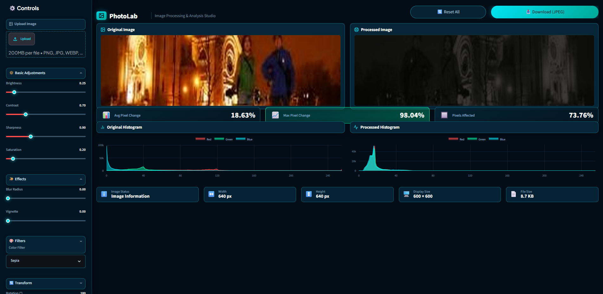
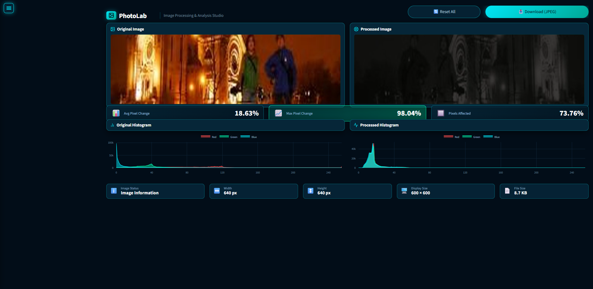
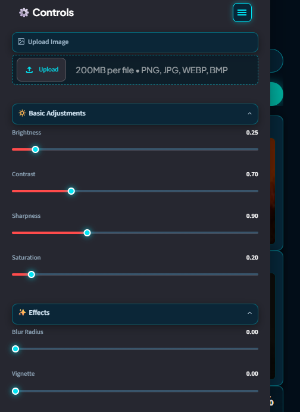

# PhotoLab - Image Processing & Analysis Studio

PhotoLab is a modern, high-performance image processing and analysis studio built with Streamlit, styled with an electric Midnight Navy & Cyan aesthetic. It features real-time adjustments, instantaneous side-by-side comparison, interactive color histograms, and deep pixel-level change analytics.

---

## 📸 Screenshots & Showcase

### 1. Desktop Dashboard (1920 × 1080 Viewport)
Full zero-scroll workstation view with compact sidebar controls, dual preview panels, metric badges, RGB histograms, and image metadata.



### 2. Collapsible Sidebar & Hamburger Navigation
Toggle the controls sidebar with the custom glowing cyan hamburger button to inspect images on a full-width canvas.



### 3. Responsive & Touch-Friendly (Mobile & Tablet)
Fluid adaptive layout designed to stack previews, analytics, and controls smoothly across smaller screens.



---

## ✨ Features
- **Basic Adjustments**: Real-time Brightness, Contrast, Sharpness, and Saturation controls.
- **Effects & Filters**: Gaussian blur, vignette masking, sepia toning, grayscale, and color inversion.
- **Transformations**: Arbitrary 360° rotation and horizontal/vertical flipping.
- **Side-by-Side Comparison**: Side-by-side original vs processed view.
- **Pixel Analytics**: Automatic calculation of Average Pixel Change (%), Maximum Pixel Change (%), and Total Pixels Affected (%).
- **Dual RGB Histograms**: Interactive side-by-side Plotly histograms comparing tonal distributions.
- **Multi-Format Export**: One-click download as JPEG (with quality control), PNG, or WebP.
- **Responsive Architecture**: Pixel-perfect desktop layout ($\ge 1025\text{px}$ non-scrollable) alongside adaptive laptop, tablet, and mobile views.

---

## Requirements
- Python 3.8+
- See `requirements.txt` for the minimal Python packages (`streamlit`, `numpy`, `pillow`).

## Quick start (local)

1. Clone the repo:

```powershell
git clone https://github.com/nayanaastakar/Photo-Lab.git
cd Photo-Lab
```

2. Install dependencies:

```powershell
python -m pip install -r requirements.txt
```

3. Run the app:

```powershell
streamlit run app.py --server.port 8503
```

Then open http://localhost:8503 in your browser.

## Docker

Build and run the container (requires Docker installed):

```bash
docker build -t photolab:latest .
docker run -p 8501:8501 photolab:latest
```

The container starts Streamlit on port `8501` inside the container.

## Included files
- Main app: [Photo-Lab/app.py](app.py)
- Image utilities: [Photo-Lab/image_processing.py](image_processing.py)
- Dependencies: [Photo-Lab/requirements.txt](requirements.txt)
- Convenience script: `run_app.ps1` (Windows)
- Dockerfile and `LICENSE`

## Troubleshooting
- If Streamlit fails to start, confirm dependencies are installed and check any error messages printed in the terminal.
- On Windows, run `.
un_app.ps1` from PowerShell (you may need to change execution policy or run as Administrator).

## Contributing
- This is a small demo project — feel free to open issues or PRs to add features or fixes.

## License
This project is licensed under the MIT License. See [LICENSE](LICENSE) for details.

